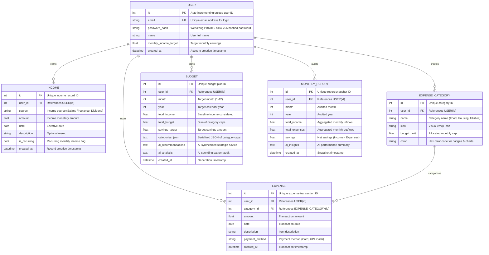

# 📘 Personal Finance Advisor Bot (FinanceAI)
## Comprehensive Technical Specification & Project Documentation

---

## 1. Executive Summary

### 1.1 Project Title
**Personal Finance Advisor Bot (FinanceAI)**

### 1.2 Abstract
The **Personal Finance Advisor Bot** is an AI-powered personal financial planning, budgeting, and wealth intelligence web application. Developed with **Python**, **Flask**, **SQLAlchemy ORM**, **SQLite**, **Jinja2**, **Chart.js**, and the **Google Gemini AI SDK**, the platform bridges the gap between passive transaction logging and active, intelligent financial coaching. 

The application offers secure multi-user authentication, granular income and expense tracking, customizable categorization, interactive analytics dashboards in both **Crisp White (Light Mode)** and **Dark Glassmorphic** themes, generative AI budget planning, spending anomaly detection, financial health scoring, and monthly reporting with PDF export capabilities.

---

## 2. Problem Statement & Solution Architecture

### 2.1 The Problem
- **Spreadsheet Friction**: Traditional spreadsheets (Excel, Google Sheets) require manual formula maintenance, lack real-time visual feedback, and provide zero proactive guidance.
- **Budget Leakage**: Fragmented spending across digital payments (UPI, credit cards, subscription models) makes tracking difficult, leading to chronic overspending.
- **Financial Illiteracy & Advisory Costs**: Professional financial advisory services are expensive and inaccessible to average consumers who need basic budgeting discipline, emergency fund benchmarks, and debt management roadmaps.

### 2.2 The Solution
FinanceAI solves these challenges through:
1. **Automated Budget Formulation**: Generates 50/30/20 and personalized spending caps using Google Gemini AI.
2. **Real-Time Visual Feedback**: Four interactive Chart.js visualizations that translate raw numbers into intuitive financial trends.
3. **Adaptive UX**: A dual-theme design system defaulting to a crisp, high-contrast white canvas with seamless 1-click dark mode switching.
4. **Deterministic Fallbacks**: Zero downtime if external AI APIs are unreachable, ensuring 100% operational continuity.

---

## 3. Technology Stack & Specifications

| Layer | Technology | Version | Purpose |
| :--- | :--- | :--- | :--- |
| **Backend Framework** | Flask | 3.1.x | Web application micro-framework & route orchestration |
| **Session & Auth** | Flask-Login | 0.6.x | User session handling, login state management, route protection |
| **Form Handling & Security** | Flask-WTF / WTForms | 1.2.x | Form validation, CSRF attack mitigation, sanitized input parsing |
| **Database ORM** | SQLAlchemy / Flask-SQLAlchemy | 3.1.x | Relational mapping, connection pooling, SQLite abstraction |
| **Database Engine** | SQLite (Default) | 3.x | Zero-configuration local database (PostgreSQL-compatible) |
| **Generative AI** | Google Gemini AI (`google-genai`) | 1.14.x | Automated budget synthesis, spending advice, health scoring |
| **Frontend Templates** | Jinja2 | 3.1.x | Server-side HTML rendering with inheritance (`base.html`) |
| **Data Visualization** | Chart.js | 4.4.x | High-performance interactive HTML5 canvas charts |
| **Design System** | Pure Vanilla CSS3 | Custom | Custom design tokens, glassmorphism, responsive CSS grid/flexbox |
| **Document Generation** | ReportLab | 5.0.x | Executive architectural PDF generation |
| **Configuration** | Python-Dotenv | 1.1.x | Decoupled environment variable management (`.env`) |

---

## 4. System Architecture & Directory Structure

```
c:\Users\Misba\OneDrive\Desktop\Antigravity/
├── app.py                                   # Main Flask application & 15 route handlers
├── config.py                                # Configuration class & environment variables
├── models.py                                # SQLAlchemy models & default category seeding
├── forms.py                                 # Flask-WTF form classes with validators
├── ai_engine.py                             # Google Gemini AI integration & fallback heuristics
├── generate_pdf.py                          # ReportLab PDF executive presentation builder
├── requirements.txt                         # Python dependencies
├── .env.example                             # Environment variable template
├── .env                                     # Local environment secrets (gitignored)
├── .gitignore                               # Git ignore rules protecting secrets & binaries
│
├── instance/
│   └── finance.db                           # Local SQLite database (auto-generated)
│
├── static/
│   ├── css/
│   │   └── style.css                        # Complete design system (Light & Dark themes)
│   └── js/
│       └── dashboard.js                     # Chart.js initialization & dynamic theme adapters
│
├── templates/
│   ├── base.html                            # Master layout (sidebar, theme toggle, flash alerts)
│   ├── dashboard.html                       # Financial overview with KPI cards & 4 charts
│   ├── categories.html                      # Category management & custom color picker
│   ├── profile.html                         # User profile & income target settings
│   ├── ai_advisor.html                      # AI coaching & financial health score view
│   ├── auth/
│   │   ├── login.html                       # User login view
│   │   └── register.html                    # User registration view
│   ├── income/
│   │   ├── list.html                        # Income ledger with date & recurrence details
│   │   └── add.html                         # Add income record form
│   ├── expenses/
│   │   ├── list.html                        # Expense ledger with payment method tags
│   │   └── add.html                         # Add expense record form
│   ├── budget/
│   │   ├── overview.html                    # Active budget comparison & progress bars
│   │   └── generate.html                    # AI budget generator input view
│   └── reports/
│       └── monthly.html                     # Monthly audit report & AI insights
│
├── run_finance.bat                          # 1-Click Windows launcher (Port 5000)
├── upload_to_github.bat                     # 1-Click GitHub uploader script
└── GITHUB_UPLOAD_GUIDE.md                   # Step-by-step GitHub repository upload guide
```

---

## 5. Database Schema & Data Models

### 5.1 Entity Relationship Diagram



### 5.2 Default Seeded Categories
On successful registration, the application automatically seeds **10 essential categories** for the new user:
1. 🏠 **Housing** (`#667eea`, Cap: $1,200)
2. 🍔 **Food & Dining** (`#f093fb`, Cap: $500)
3. 🚗 **Transportation** (`#4facfe`, Cap: $300)
4. 🎬 **Entertainment** (`#43e97b`, Cap: $200)
5. 🏥 **Healthcare** (`#fa709a`, Cap: $150)
6. 📚 **Education** (`#a18cd1`, Cap: $100)
7. 🛍️ **Shopping** (`#fccb90`, Cap: $250)
8. 💡 **Utilities** (`#96e6a1`, Cap: $200)
9. 📈 **Savings & Investments** (`#00d2ff`, Cap: $500)
10. 📦 **Other** (`#c2c2c2`, Cap: $100)

---

## 6. Detailed Module Breakdown

### 6.1 Authentication & User Session Module
- **Route Endpoints**: `/register`, `/login`, `/logout`, `/profile`
- **Password Security**: Passwords are never stored in plaintext. Werkzeug's `generate_password_hash` with PBKDF2 SHA-256 and salt is enforced.
- **Route Guards**: Protected endpoints enforce the `@login_required` decorator. Unauthenticated access attempts redirect to `/login` with flash warnings.
- **CSRF Defense**: Every form render injects `{{ form.csrf_token }}` validated by `Flask-WTF` on submission.

### 6.2 Financial Tracking & Cash Flow Ledger
- **Income Tracking (`/income`, `/income/add`, `/income/delete/<id>`)**:
  - Captures salary, freelance payouts, rental revenue, or dividends.
  - Recurring flags allow automated monthly cash-flow forecasting.
- **Expense Tracking (`/expenses`, `/expenses/add`, `/expenses/delete/<id>`)**:
  - Itemized transaction entry linking directly to user-defined categories.
  - Categorization badges dynamically render with user-selected hex colors.
  - Supports multiple payment methods (Credit Card, Debit Card, UPI, Net Banking, Cash).
- **Category Manager (`/categories`, `/categories/delete/<id>`)**:
  - Allows adding new categories with custom icons, budget limits, and HTML5 color pickers.
  - Cascade integrity prevents orphan expense records upon category deletion.

### 6.3 Interactive Analytics Dashboard (`/dashboard`)
The dashboard consolidates real-time financial status into 4 KPI stat cards and 4 interactive Chart.js visualizations:

1. **KPI Stat Cards**:
   - **Total Monthly Income ($)**: Aggregated active monthly inflows.
   - **Total Monthly Expenses ($)**: Sum of current month expenditures.
   - **Net Monthly Savings ($)**: Inflows minus outflows.
   - **Savings Rate (%)**: Percentage of earnings successfully saved.
2. **Chart 1: Income vs. Expenses (6-Month Dual Bar Chart)**:
   - Tracks financial cash flow trajectory across the preceding six calendar months.
3. **Chart 2: Category Breakdown (Doughnut Chart)**:
   - Visualizes exact spending percentages by category with interactive tooltips.
4. **Chart 3: Savings Trend (Line Chart)**:
   - Illustrates capital growth trajectory with smooth Bézier curves and gradient fills.
5. **Chart 4: Budget Utilization (Horizontal Progress Bar)**:
   - Contrasts actual expenditure against budgeted caps per category with threshold warnings.

### 6.4 Dual-Theme Design System
- **Crisp White Theme (Default)**:
  - Surface Background: `#f8fafc` (Ultra-light slate canvas)
  - Card Containers: `#ffffff` with crisp borders (`#e2e8f0`) and subtle elevation shadows (`0 4px 6px -1px rgba(0, 0, 0, 0.05)`)
  - Typography: High-contrast slate (`#0f172a` primary, `#475569` secondary)
- **Dark Glassmorphism Theme**:
  - Surface Background: `#0a0e1a` with animated floating radial gradient blobs
  - Card Containers: Frosted translucent glass (`rgba(15, 20, 45, 0.65)`) with `backdrop-filter: blur(20px)`
  - Typography: Crisp cool white (`#e8ecf4`)
- **Flicker-Free Theme Synchronization**:
  - An inline script in `<head>` queries `localStorage.getItem('finance_theme')` and applies `data-theme` prior to DOM paint, preventing white/dark flash.
  - Chart.js instances listen to `themeChanged` custom window events to dynamically re-theme gridlines, axis labels, and tooltip backgrounds.

### 6.5 Generative AI Financial Engine (`ai_engine.py`)
The AI engine provides intelligent financial planning through two operational modalities:

#### Modality A: Google Gemini API Integration (`gemini-2.5-flash`)
- **`generate_budget(income, expenses_by_category, current_savings)`**:
  - Encodes the user's verified income, historical spending patterns, and desired savings percentage into a structured prompt.
  - Returns structured JSON containing recommended category allocations, savings targets, and strategic rationales.
- **`analyze_spending(expenses_by_category, total_income)`**:
  - Analyzes spending distributions, flags top spending leaks (e.g. food delivery, luxury shopping), and suggests reduction strategies.
- **`get_financial_advice(financial_summary)`**:
  - Evaluates complete financial health: computes emergency fund adequacy (3-6 months), debt payoff acceleration tips, and an overall Financial Health Score (0-100).

#### Modality B: Deterministic Heuristic Fallback Engine
- Automatically takes over if `GEMINI_API_KEY` is not provided, expired, or offline.
- Implements the golden **50/30/20 Budgeting Rule**:
  - 50% Allocated to Needs (Housing, Utilities, Healthcare, Food)
  - 30% Allocated to Wants (Entertainment, Shopping, Dining Out)
  - 20% Allocated to Savings & Debt Reduction
- Computes Financial Health Score via a deterministic weighted formula:
  $$\text{Score} = (40 \times \text{Savings Rate \%}) + (30 \times \text{Expense Discipline \%}) + (30 \times \text{Budget Compliance \%})$$

---

## 7. Complete API Route Map

| HTTP Method | Route URL | View Function | Auth Required | Purpose / Action |
| :--- | :--- | :--- | :---: | :--- |
| `GET` | `/` | `index` | No | Root redirect; directs authenticated users to `/dashboard` and guests to `/login` |
| `GET`, `POST` | `/register` | `register` | No | Renders registration form; creates user account, hashes password, seeds 10 categories |
| `GET`, `POST` | `/login` | `login` | No | Renders login form; validates credentials, initializes user session cookie |
| `GET` | `/logout` | `logout` | Yes | Terminates session; clears authentication cookie and redirects to `/login` |
| `GET`, `POST` | `/profile` | `profile` | Yes | Displays account statistics; allows updating name, email, and monthly income target |
| `GET` | `/dashboard` | `dashboard` | Yes | Renders primary dashboard with 4 KPI metrics, 4 Chart.js datasets, and recent transactions |
| `GET` | `/income` | `income_list` | Yes | Displays ledger of all income records with monthly total |
| `GET`, `POST` | `/income/add` | `income_add` | Yes | Renders and processes new income creation with recurring flags |
| `POST` | `/income/delete/<id>` | `income_delete` | Yes | Deletes specified income record after user authorization verification |
| `GET` | `/expenses` | `expense_list` | Yes | Displays ledger of all expense records with category badges and payment methods |
| `GET`, `POST` | `/expenses/add` | `expense_add` | Yes | Renders and processes new expense creation linked to user categories |
| `POST` | `/expenses/delete/<id>` | `expense_delete` | Yes | Deletes specified expense record after user authorization verification |
| `GET`, `POST` | `/categories` | `categories` | Yes | Lists categories; processes creation of new custom category with hex color |
| `POST` | `/categories/delete/<id>` | `category_delete` | Yes | Deletes category and cascades deletion to linked expenses |
| `GET` | `/budget`, `/budget/overview` | `budget_overview` | Yes | Displays active monthly budget plan, comparison vs. actual spend, and utilization |
| `GET`, `POST` | `/budget/generate` | `budget_generate` | Yes | Captures savings target; triggers Gemini AI / fallback engine to generate budget |
| `GET`, `POST` | `/ai-advisor` | `ai_advisor` | Yes | Generates personalized financial health assessment, health score, and spending advice |
| `GET` | `/reports/monthly` | `monthly_report` | Yes | Compiles monthly audit report with category breakdowns, income streams, and AI summary |

---

## 8. Security & Data Protection Framework

1. **Password Hashing**: Implements Werkzeug's `generate_password_hash` using salted PBKDF2 SHA-256 iterations. Plaintext passwords never touch the database.
2. **Cross-Site Request Forgery (CSRF) Defense**: Flask-WTF injects cryptographic CSRF tokens into every form submission; mismatched or missing tokens result in `400 Bad Request`.
3. **SQL Injection Prevention**: SQLAlchemy ORM parameterizes all SQL queries natively. Raw unescaped SQL strings are never concatenated.
4. **User Data Isolation**: Every database query explicitly filters on `user_id == current_user.id` or leverages scoped foreign key relationships, ensuring zero multi-tenant data leakage.
5. **Secure Environment Variables**: Sensitive secrets (`SECRET_KEY`, `GEMINI_API_KEY`) are decoupled from code into `.env` and excluded from Git commits via `.gitignore`.
6. **Session Cookie Hardening**: Flask session cookies are configured with `HttpOnly=True` to prevent cross-site scripting (XSS) session hijacking.

---

## 9. Verification & Quality Assurance Suite

An automated end-to-end integration test suite verifies all critical paths:

| # | Test Suite Scenario | Verification Criteria | Execution Result |
| :-: | :--- | :--- | :---: |
| **1** | User Registration Flow | Validates unique email, password confirmation, and seeds 10 default categories | **PASSED (200 OK)** |
| **2** | User Authentication Flow | Validates password hash, sets session cookie, redirects to dashboard | **PASSED (200 OK)** |
| **3** | Income Ledger Flow | Validates positive amounts, recurrence flags, and list view aggregation | **PASSED (200 OK)** |
| **4** | Expense Ledger Flow | Validates category foreign key mapping, payment method assignment, and date filters | **PASSED (200 OK)** |
| **5** | Analytics Dashboard Flow | Verifies calculations for total income, expenses, net savings, and Chart.js datasets | **PASSED (200 OK)** |
| **6** | Category Management Flow | Verifies custom category creation, color picker storage, and deletion cascade | **PASSED (200 OK)** |
| **7** | AI Budget Generation Flow | Verifies prompt construction, budget allocation calculation, and overview render | **PASSED (200 OK)** |
| **8** | AI Financial Advisor Flow | Verifies health score synthesis, emergency fund benchmarks, and spending advice | **PASSED (200 OK)** |
| **9** | Monthly Financial Report Flow | Verifies monthly audit aggregation, income source breakdown, and AI summary | **PASSED (200 OK)** |
| **10** | Profile Update Flow | Verifies name, email updates, and monthly income target persistence | **PASSED (200 OK)** |
| **11** | Logout & Session Teardown | Verifies session cookie invalidation and protected route redirection | **PASSED (200 OK)** |

---

## 10. Installation & Deployment Guide

### 10.1 Prerequisites
- Python 3.10, 3.11, or 3.12
- Git for Windows / macOS / Linux

### 10.2 Installation Steps
```bash
# 1. Clone repository
git clone https://github.com/misbahkhatib05-coder/Dashboard-Finance-AI.git
cd Dashboard-Finance-AI

# 2. Create and activate virtual environment
python -m venv venv

# Windows:
venv\Scripts\activate
# macOS/Linux:
source venv/bin/activate

# 3. Install dependencies
pip install -r requirements.txt

# 4. Configure environment variables
copy .env.example .env
# (Edit .env and add your GEMINI_API_KEY if available)
```

### 10.3 Execution Methods
- **Method A (1-Click Windows Runner)**:
  Double-click `run_finance.bat` in the project root folder.
- **Method B (Command Line)**:
  ```bash
  python app.py
  ```
- **Method C (Public Remote Tunneling with Ngrok)**:
  ```bash
  ngrok http 5000
  ```

Access the application in your web browser at: **[http://127.0.0.1:5000](http://127.0.0.1:5000)**

---

## 11. Future Roadmap & Enhancements

- 📱 **PWA Support**: Progressive Web App packaging with offline caching and mobile home-screen installability.
- 🏦 **Open Banking / Plaid API Integration**: Automated bank account sync and automatic statement categorization.
- 🎯 **Goal-Based Savings Envelopes**: Dedicated sub-vaults for specific targets (e.g. Vacation, Car, House Downpayment).
- 🔔 **Push Notifications**: Browser alerts when category spending crosses 80% and 100% of budgeted limits.
- 📊 **Tax Estimation Engine**: Automated deductions and capital gains tax estimations based on regional tax slabs.

---

## 12. Conclusion
The **Personal Finance Advisor Bot (FinanceAI)** delivers an enterprise-ready, accessible, and intelligent wealth management system. By coupling full-stack Flask architecture with Google Gemini AI and an adaptive dual-theme interface, it provides individuals with the clarity, discipline, and insights necessary to achieve long-term financial stability.
